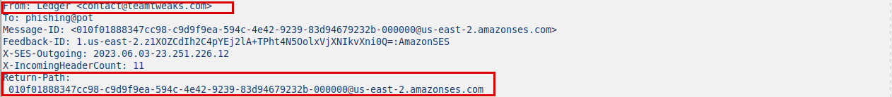
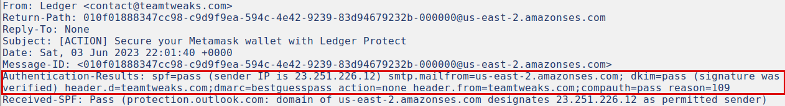
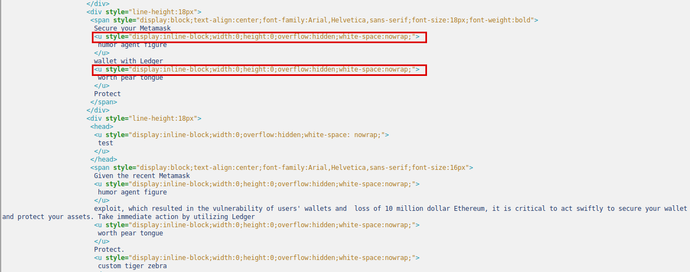
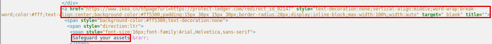
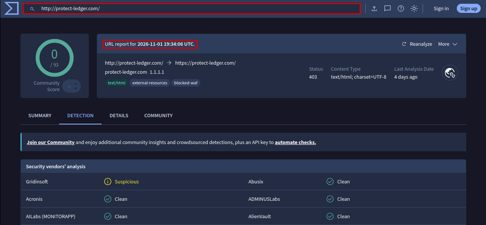
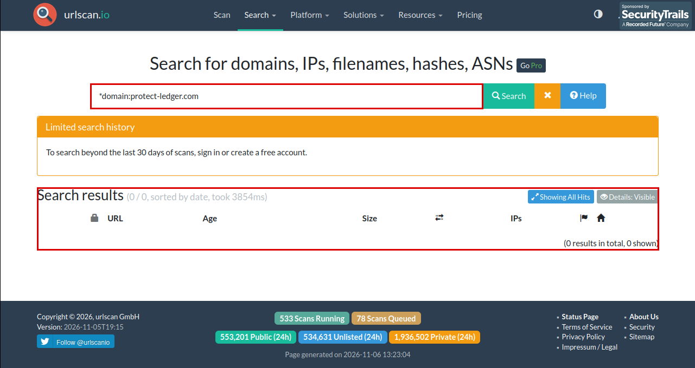

# Phishing Email Analysis: Fake "Ledger Protect" crypto-wallet alert

| | |
|---|---|
| **Analyst** | Shanwaz Mollick |
| **Sample source** | [phishing_pot](https://github.com/rf-peixoto/phishing_pot), file: sample-10163.eml |
| **Date analysed** | 2026-11-05 (email sent 2023-06-03); external lookups checked 2026-11-06 |
| **Tools** | Text editor, Python 3 `email` module (own parsing script, `parser.py`), `whois`, VirusTotal, urlscan.io |
| **Verdict** | Phishing, confidence high |

> Indicators are defanged (`[.]`, `hxxp`), except the verbatim header excerpt in section 2 and the screenshots. The email was analysed as text in a VM. No links were opened and no attachments were run.

## 1. Summary

The email poses as Ledger, the hardware crypto-wallet maker, and claims a MetaMask exploit has put users' funds at risk. It urges the reader to "act swiftly" by clicking a button. The button is routed through a redirect on an unrelated retail website to a look-alike domain, `protect-ledger[.]com`. I assess it as phishing, most likely aimed at stealing wallet credentials or recovery phrases.

## 2. Header analysis

| Field | Value | Why it matters |
|---|---|---|
| From | `Ledger <contact@teamtweaks[.]com>` | The display name claims Ledger, but the address domain is `teamtweaks[.]com`, not Ledger's own domain |
| Return-Path | `010f0188…-000000@us-east-2.amazonses[.]com` | Does not match From. This is normal for Amazon SES, which uses its own bounce domain, so it is not suspicious by itself. It identifies the sending service |
| Reply-To | Not present | No separate reply address |
| Received chain | Four `Received` headers. The bottom one records Microsoft receiving the message from `e226-12.smtp-out.us-east-2.amazonses[.]com` (`23.251.226[.]12`); the other three are internal Microsoft hops | Sent through Amazon SES, a bulk-mail service anyone can use. Hosting on SES says nothing about legitimacy, and the IP is shared |
| SPF / DKIM / DMARC | SPF pass (for `amazonses[.]com`), DKIM pass (`d=teamtweaks[.]com` and `d=amazonses[.]com`), DMARC `bestguesspass` for `header.from=teamtweaks[.]com`, `compauth=pass` | Everything passes, but only for the sender's own domain (`teamtweaks[.]com`) and SES, not for Ledger. Authentication proves who sent the message, not that it is honest |
| Message-ID domain | `amazonses[.]com` | Consistent with SES sending. It does not match the claimed sender (Ledger) |

Microsoft also scored the message `X-MS-Exchange-Organization-SCL: 1` (not spam), so it would have reached the inbox.

Raw header lines (evidence):

```
From: Ledger <contact@teamtweaks.com>
Return-Path: 010f01888347cc98-c9d9f9ea-594c-4e42-9239-83d94679232b-000000@us-east-2.amazonses.com
Message-ID: <010f01888347cc98-c9d9f9ea-594c-4e42-9239-83d94679232b-000000@us-east-2.amazonses.com>
Authentication-Results: spf=pass (sender IP is 23.251.226.12) smtp.mailfrom=us-east-2.amazonses.com; dkim=pass (signature was verified) header.d=teamtweaks.com;dmarc=bestguesspass action=none header.from=teamtweaks.com;compauth=pass reason=109
Received-SPF: Pass (protection.outlook.com: domain of us-east-2.amazonses.com designates 23.251.226.12 as permitted sender) receiver=protection.outlook.com; client-ip=23.251.226.12; helo=e226-12.smtp-out.us-east-2.amazonses.com; pr=C
Received: from e226-12.smtp-out.us-east-2.amazonses.com (23.251.226.12) by DB3EUR04FT048.mail.protection.outlook.com (10.152.25.38) with Microsoft SMTP Server (version=TLS1_2, cipher=TLS_ECDHE_RSA_WITH_AES_256_GCM_SHA384) id 15.20.6477.14 via Frontend Transport; Sat, 3 Jun 2023 22:01:41 +0000
```





## 3. Body analysis

- **Sender impersonated:** Ledger (hardware crypto wallets); it also name-drops MetaMask. The address is on `teamtweaks[.]com`.
- **Pressure tactics:** fear plus urgency. It claims a "recent Metamask exploit" caused a "$10 million Ethereum" loss, says it is "critical to act swiftly", asks for "immediate action", and puts `[ACTION]` in the subject line. The incident claim was not verified.
- **Link text versus real link:** the only link, with the button text "Safeguard your assets →", points to `hxxps://www[.]ikea[.]cn/h5page?url=hxxps://protect-ledger[.]com/redirect_id_02147`. The visible text gives no hint of the destination, and a legitimate Ledger email would link to Ledger's own domain. The `url=` parameter suggests an open redirect on a legitimate retail site being used to carry the victim to `protect-ledger[.]com` (not confirmed, see §7). "View in Browser" and "click here" in the text are not links.
- **Filter evasion (hidden text):** random words such as "worth pear tongue", "humor agent figure" and "custom tiger zebra" are inserted inside the brand name and sentences, wrapped in `<u>` elements styled `width:0; height:0; overflow:hidden`. They are invisible to the reader but break keyword and signature matching. This is a "hidden text salting" technique and is a strong sign of intent.
- **Spelling, formatting and branding:** the visible text reads cleanly, with a generic greeting and no personalisation. The only image is hotlinked from `img[.]news[.]ledger[.]com` via Google's image proxy, which suggests the attacker copied a genuine Ledger newsletter (an inference, not confirmed).





## 4. URLs

Lookups were run on 2026-11-06, about three years after the email was sent. Nothing was opened or scanned.

| URL (defanged) | Domain age / registrar | Reputation (VirusTotal, urlscan.io) | Notes |
|---|---|---|---|
| `hxxps://www[.]ikea[.]cn/h5page?url=hxxps://protect-ledger[.]com/redirect_id_02147` | `ikea[.]cn`: created 2003-03-17, registrant is IKEA's Chinese e-commerce entity, registrar Alibaba Cloud (Wanwang) | Not checked, it is a legitimate site | The outer link. A well-known retail domain used as a redirector, so it is probably abused, not malicious itself |
| `protect-ledger[.]com` (embedded destination) | Created 2026-03-30, registrar Global Domain Group LLC | VirusTotal (existing report from 2026-11-01): 0 of 93 vendors flagged it malicious, 1 (Gridinsoft) marked it suspicious. The site answered HTTP 403 (tagged `blocked-waf`). urlscan.io: no results (free search covers only the last 30 days) | Look-alike of Ledger's brand. The current registration is almost three years newer than the email, so it says nothing about who held the domain in 2023 (see §7) |
| `teamtweaks[.]com` (sender domain) | Created 2008-11-05, registrar Name.com, Inc. | Not checked | Unrelated to Ledger. An old domain, so it may be compromised or reused rather than created for this campaign (inference, not confirmed) |
| `hxxps://img[.]news[.]ledger[.]com/…png` | n/a | n/a | Genuine Ledger asset, hotlinked. Not malicious, do not block |





## 5. Attachments

No attachments. The message has a single HTML body part and no file parts.

## 6. MITRE ATT&CK mapping

| Technique | Evidence | Confidence |
|---|---|---|
| T1566.002 Phishing: Spearphishing Link | A single call-to-action link that hides its destination behind an open-redirect URL to a look-alike domain, with a fear-based pretext | High |

## 7. Verdict and reasoning

**Phishing, confidence high.** The strongest evidence:

1. **Brand and sender mismatch.** The message claims to be Ledger but is sent from `teamtweaks[.]com` through a generic bulk-mail service.
2. **Hidden destination.** The only link goes through a redirect on an unrelated site to a look-alike domain (`protect-ledger[.]com`).
3. **Evasion and pressure.** Invisible random words are injected to defeat filters, and the message uses a fake security incident to create urgency.

Passing SPF, DKIM and DMARC does **not** make this legitimate. They only show the message really came from `teamtweaks[.]com` (and SES). Microsoft's filter rated it SCL 1 (not spam), so the technical checks alone would have let it through.

**Not confirmed:** what the destination page does (links not opened, so no capture of a fake login or "connect wallet" page), whether `teamtweaks[.]com` is attacker-owned or compromised, whether the redirect still works, and whether the claimed MetaMask incident ever happened. The registration data and reputation results in §4 were collected in 2026. `protect-ledger[.]com` was registered on 2026-03-30, so the domain may have lapsed and been re-registered since 2023. Today's clean or empty reputation results therefore neither clear nor confirm what the domain did in 2023. The verdict rests on the email's content, not on those lookups.

## 8. Recommended response

1. Block `contact@teamtweaks[.]com` and the domain `teamtweaks[.]com`, and block `protect-ledger[.]com` and the full redirect URL. Do **not** block `23.251.226[.]12` (shared Amazon SES) or `ikea[.]cn` as a whole, since that would block legitimate mail and traffic.
2. Search the mail system for the same sender, subject or URL pattern and delete matching messages.
3. Check whether anyone clicked or replied. If so, treat any wallet seed phrase or credentials entered as compromised: move funds to a new wallet, reset passwords, and review sign-ins.
4. Report the message to Ledger, to AWS (SES abuse), and to the owner of the abused redirector, and to the reporting mailbox.
5. Add the indicators below to the blocklist.

## 9. Indicators of compromise

| Type | Indicator |
|---|---|
| Sender | `contact@teamtweaks[.]com` |
| Sending IP | `23.251.226[.]12` (Amazon SES, shared, do not block by IP) |
| Domain | `teamtweaks[.]com`, `protect-ledger[.]com` |
| URL | `hxxps://www[.]ikea[.]cn/h5page?url=hxxps://protect-ledger[.]com/redirect_id_02147` |
| File hash | None (no attachment) |
| Message-ID | `010f01888347cc98-c9d9f9ea-594c-4e42-9239-83d94679232b-000000@us-east-2.amazonses[.]com` |

## 10. Method notes

Headers, MIME parts and HTML were read with a small Python `email`-module script (`parser.py` in this folder); nothing was rendered or opened. The body is base64-encoded, so a plain `grep -c 'href='` on the raw file returns 0; links were confirmed by decoding the body with the `email` module instead. Reputation and registration lookups were done against external services only. The raw `.eml` is not included in this repository.

Source: [phishing_pot](https://github.com/rf-peixoto/phishing_pot).
