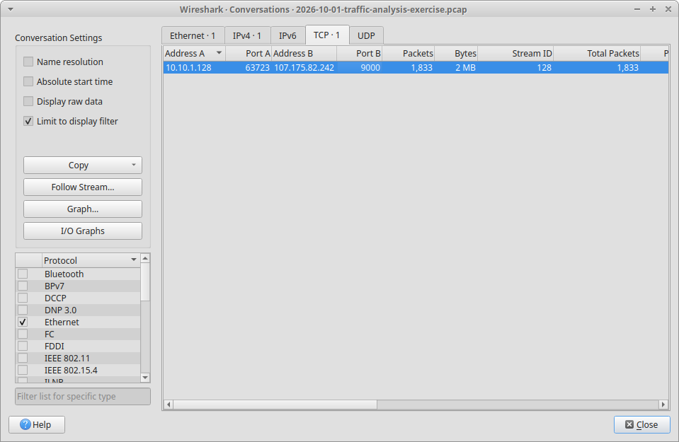
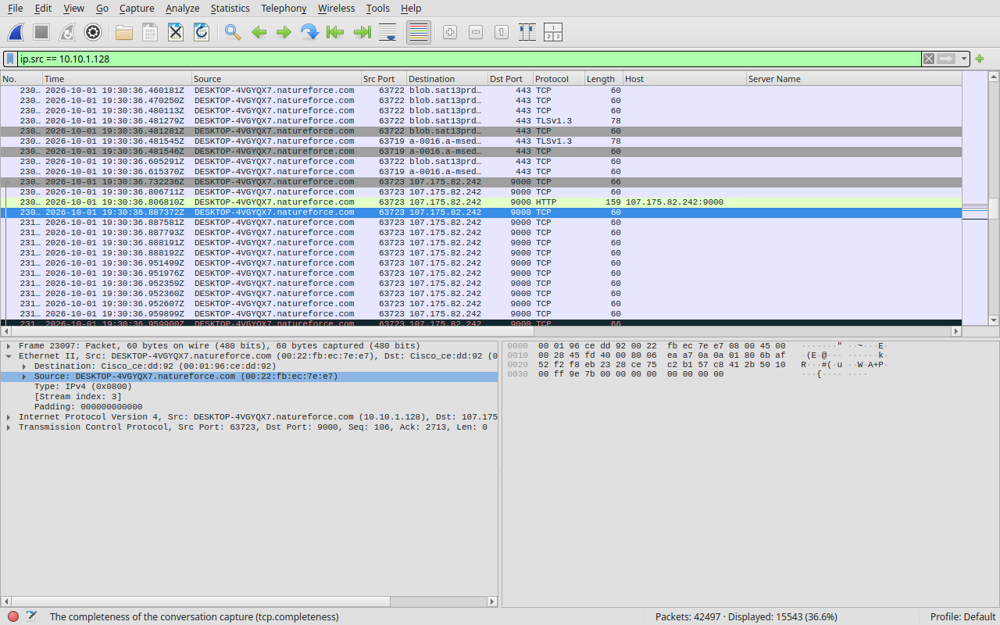
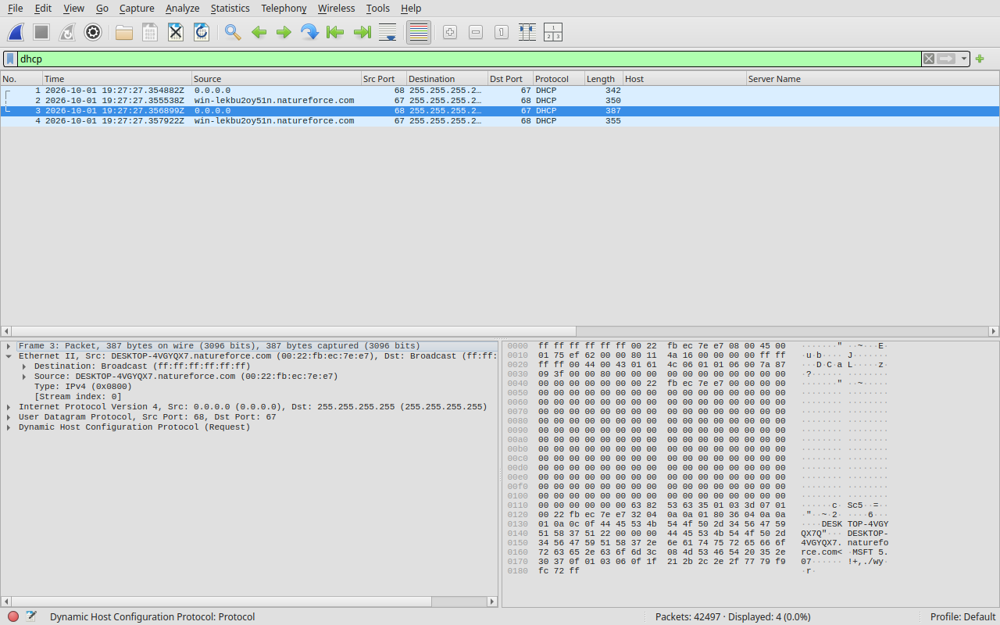
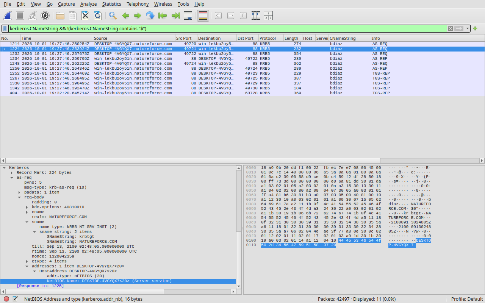
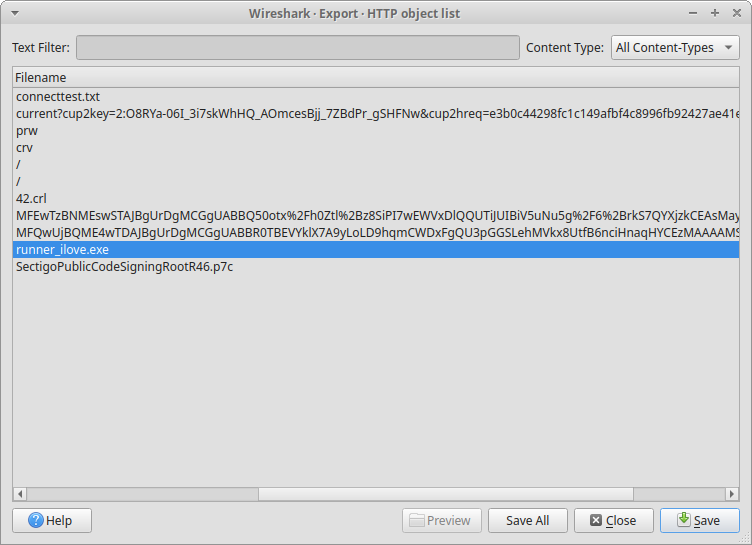
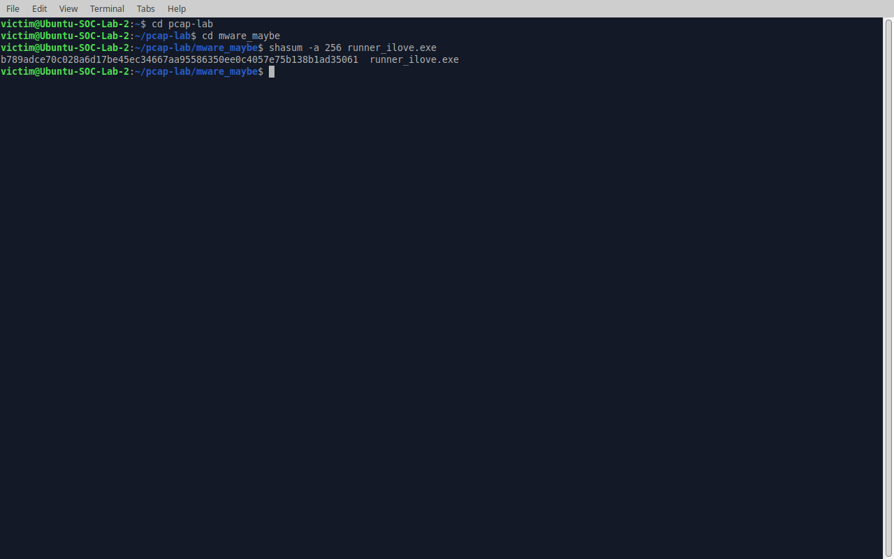

# Incident Report: Windows Host Infection (Traffic Analysis Exercise, 2026-10-01)

| | |
|---|---|
| **Analyst** | Shanwaz Mollick |
| **Exercise source** | [malware-traffic-analysis.net, 2026-10-01](https://www.malware-traffic-analysis.net/2026/10/01/index.html) |
| **Evidence** | Packet capture (`2026-10-01-traffic-analysis-exercise.pcap`, 42,497 packets, about 40.5 minutes, 2026-10-01 19:27:27 to 20:07:58 UTC) |
| **Tools** | Wireshark, `shasum` (xubuntu in VirtualBox) |
| **Status** | Confirmed compromise: malicious executable downloaded, followed by a large encrypted session to a flagged C2 address |

> All timestamps are UTC. Indicators are defanged (`[.]`, `hxxp`). The packet capture and the extracted executable are intentionally **not** included in this repository.

---

## 1. Executive summary

Two SOC alerts fired for the same Windows workstation: a Windows executable delivered over an unusual TCP port (`107.175.82[.]242:9000`) and traffic to a known RAT command-and-control (C2) address on port 443. Review of the capture confirms the first alert and supports the second.

At 19:30:36 UTC, workstation `10.10.1.128` (`DESKTOP-4VGYQX7`, user `bdiaz`) downloaded a 1,646,592-byte Windows executable, `runner_ilove.exe`, over plain HTTP from a raw IP address using the `curl` user agent. Eight seconds later the host began a long-lived, mostly server-to-client TLS session with `195.63.128[.]106:443`, transferring about 14 MB. The host should be treated as compromised and isolated.

## 2. Environment

| Item | Value |
|---|---|
| LAN | `10.10.1[.]0/24` |
| Domain | `natureforce[.]com` (AD name `NATUREFORCE`) |
| Domain controller | `10.10.1[.]10`, `WIN-LEKBU2OY51N` |
| Gateway | `10.10.1[.]1` |

## 3. Victim details

| Field | Value | Evidence |
|---|---|---|
| IP address | `10.10.1[.]128` | Sole internal peer of `107.175.82[.]242` (`ip.addr == 107.175.82.242`); also the internal endpoint in all of the largest conversations (Statistics → Conversations) |
| MAC address | `00:22:fb:ec:7e:e7` | Ethernet source on packets sent by the victim (`ip.src == 10.10.1.128` → Ethernet II → Source) |
| Host name | `DESKTOP-4VGYQX7` | DHCP Host Name option (`dhcp`); Kerberos machine account `DESKTOP-4VGYQX7$`; both agree |
| User account | `bdiaz` (realm `NATUREFORCE`) | Kerberos AS-REQ from `10.10.1[.]128` to the DC on port 88 (`kerberos.CNameString && !(kerberos.CNameString contains "$")`) |
| Malware SHA-256 | `b789adce70c028a6d17be45ec34667aa95586350ee0c4057e75b138b1ad35061` | HTTP object export, hashed locally (see §4.5) |

## 4. Analysis

### 4.1 Identifying the victim IP

Starting from the alert indicator, I filtered `ip.addr == 107.175.82.242`. All packets involve one internal address, `10.10.1.128`, and that address initiated the TCP connection (SYN). Statistics → Conversations (TCP tab, sorted by bytes) shows the same address as the internal side of every large conversation, consistent with a capture taken from a single host.

### 4.2 MAC address

Filter: `ip.src == 10.10.1.128`. In the packet details, Ethernet II → Source is `00:22:fb:ec:7e:e7` on every outbound packet. The destination MAC on those packets is the gateway, so only the source field identifies the victim.

### 4.3 Host name

Filter `dhcp` shows a request from the victim's MAC with Host Name `DESKTOP-4VGYQX7`. I corroborated it with Kerberos: the machine account `DESKTOP-4VGYQX7$` appears in requests from `10.10.1.128`. Two independent sources agree.

NetBIOS (`nbns`) also showed a different name, `WIN-LEKBU2OY51N`. That is the domain controller listed in the exercise background, so it was excluded as a different host.

### 4.4 User account

Filter: `kerberos.CNameString && !(kerberos.CNameString contains "$")`. The only non-machine principal is `bdiaz`, in AS-REQ packets sent from `10.10.1.128` to `10.10.1.10:88`, realm `NATUREFORCE`. NTLM authentication (`ntlmssp.auth.username`) returned no results, so identity was taken from Kerberos alone.

### 4.5 Malicious executable and hash

1. In File → Export Objects → HTTP, the entry with hostname `107.175.82.242:9000` and filename `runner_ilove.exe` was saved to an isolated folder (never executed).
2. The file was hashed locally:
   - `shasum -a 256 runner_ilove.exe` (macOS/Linux) or `Get-FileHash .\runner_ilove.exe -Algorithm SHA256` (Windows)
3. Result: `b789adce70c028a6d17be45ec34667aa95586350ee0c4057e75b138b1ad35061`

Cross-check: I independently reassembled the TCP stream from `107.175.82[.]242:9000` and hashed the HTTP body (1,646,592 bytes, matching `Content-Length`). The hash is identical. The body begins with the bytes `MZ`, the Windows executable (PE) signature.

Scanning it with VirusTotal the score comes out as 48/71 the system flagged it as malicious.

HTTP response details worth noting:

| Field | Value |
|---|---|
| Status | `200 OK` |
| Content-Type | `binary/octet-stream` |
| Content-Length | 1,646,592 bytes |
| Server | MinIO (S3-compatible object storage) |
| Last-Modified | Thu, 01 Oct 2026 18:46:36 GMT (about 44 minutes before the download) |
| Request User-Agent | `curl/8.21.0` |

Scanning the extracted hash file in VirusTotal the score comes out to be: `48/71` security vendors flagging it as malicious.

### 4.6 Timeline

| Time (UTC) | Frame | Event |
|---|---|---|
| 19:27:27 | 1 | Capture starts |
| 19:29:00 | 8235 | `GET hxxp://holtandberyl[.]com/prw` to `35.170.55[.]9:80`, user agent `curl/8.21.0`. The domain was resolved by DNS in frame 8231 |
| 19:29:01 | 8345 | `GET hxxp://holtandberyl[.]com/crv`, same host and user agent. Both responses are small (178 bytes, `text/html`) |
| 19:30:36 | 23091 | `GET hxxp://107.175.82[.]242:9000/wilow/runner_ilove[.]exe`, user agent `curl/8.21.0`. Response `200 OK`, 1,646,592-byte PE file. No DNS lookup preceded this connection (raw IP) |
| 19:30:44 | 24963 | First packet to `195.63.128[.]106:443`. Mostly server-to-client TLS, about 14 MB received versus about 0.4 MB sent. No DNS lookup and no readable server name |
| 20:07:58 | | Capture ends |

## 5. Findings and caveats

- **Confirmed:** an executable was delivered over HTTP on a non-standard port (9000) from a raw IP with no preceding DNS lookup, using `curl`, a tool not normally used for interactive browsing. The two earlier `curl` requests to `holtandberyl[.]com` use the same user agent about 97 seconds before the EXE download and may be related, but their purpose was not determined from the capture.
- **Supported, not independently confirmed:** the C2 classification. The session to `195.63.128[.]106:443` is TLS-encrypted, so content cannot be read. The classification rests on the SOC alert, the timing (8 seconds after the executable download), the raw-IP connection, and the transfer volume.
- **Discrepancy to note:** the alert text lists the C2 address as `195.64.128[.]106`, but the capture contains `195.63.128[.]106` and no packets for `195.64.128[.]106`. Either the alert text has a typo or the alert refers to a different address. Both are listed under indicators below.
- **Not assessed:** other external hosts seen early in the capture (for example `54.201.5.185`, TLS name `www.ars-soar[.]com`, and `44.203.10.190`) and a ~12 MB download from an Azure Blob Storage hostname at 19:30:29. No determination was made on these.
- The capture does not contain the executable's runtime behavior, so no claims are made about its capabilities beyond the alert text.

## 6. MITRE ATT&CK mapping

Mapped to behavior seen in the capture only. Execution of the file was not observed.

| Technique | What was seen | Confidence |
|---|---|---|
| T1105 Ingress Tool Transfer | `curl` downloaded the 1,646,592-byte `runner_ilove.exe` over HTTP from `107.175.82[.]242:9000` | Confirmed in capture |
| T1571 Non-Standard Port | The executable was served over HTTP on TCP port 9000 | Confirmed in capture |
| T1071.001 Application Layer Protocol: Web Protocols | Long-lived TLS session to `195.63.128[.]106:443` starting 8 seconds after the download | Suspected: based on the SOC alert, timing, raw-IP connection and transfer volume, not on readable content |

## 7. Indicators of compromise

| Type | Indicator | Note |
|---|---|---|
| IP:port | `107.175.82[.]242:9000` | EXE delivery over HTTP |
| URL | `hxxp://107.175.82[.]242:9000/wilow/runner_ilove[.]exe` | Malicious download |
| File | `runner_ilove.exe` | 1,646,592 bytes, PE |
| SHA-256 | `b789adce70c028a6d17be45ec34667aa95586350ee0c4057e75b138b1ad35061` | |
| IP:port | `195.63.128[.]106:443` | Observed in capture, about 14 MB TLS session |
| IP:port | `195.64.128[.]106:443` | From alert text, not seen in capture |
| Domain | `holtandberyl[.]com` (`35.170.55[.]9`) | Paths `/prw`, `/crv` via `curl` shortly before the EXE download |
| User agent | `curl/8.21.0` | On the three requests above |

## 8. Recommended actions

1. Isolate `DESKTOP-4VGYQX7` (`10.10.1[.]128`) from the network.
2. Block the IPs and domain above at the perimeter and DNS layers.
3. Reset credentials for `bdiaz`, and review authentication logs for activity from other hosts using this account.
4. Collect the executable and submit it to reputation and sandbox services; scan the host with EDR and check for persistence.
5. Review proxy and firewall logs for other hosts contacting the same indicators.

## 9. Method notes

Filters used: `ip.addr == …`, `ip.src == …`, `dhcp`, `nbns`, `kerberos.CNameString`, `ntlmssp.auth.username`, `http.request`, `tls.handshake.type == 1`, `dns`. Statistics → Conversations and Endpoints, Follow TCP Stream, and File → Export Objects → HTTP were also used.

Results were compared with the exercise author's published answer key after the analysis; the victim details and hash matched.

## 10. References

- Exercise: <https://www.malware-traffic-analysis.net/2026/10/01/index.html>
- Author's tutorials: <https://www.malware-traffic-analysis.net/tutorials.html>
