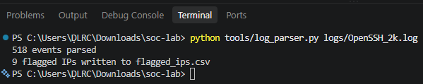
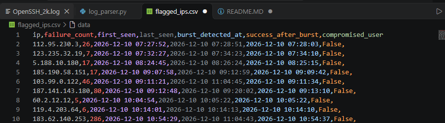

# SSH Brute-Force Log Parser

A small Python tool that reads OpenSSH authentication logs (syslog format), detects brute-force login attempts, and writes the results to a CSV file an analyst can review. Part of my SOC home-lab portfolio.

**Standard library only. No `pip install` needed.** Python 3.8+.

## What it does

1. Reads an OpenSSH auth log line by line.
2. Parses every `Failed password` and `Accepted password` line into a structured event (timestamp, username, source IP, success/failure).
3. Flags any source IP with **5 or more failed logins within 10 minutes**.
4. Checks whether that IP had a **successful login after the burst**, which suggests the password may have been guessed.
5. Writes one row per flagged IP to `flagged_ips.csv` and prints high-severity findings to the terminal.

## Project layout

```
ssh-bruteforce-parser/
├── tools/log_parser.py          the parser
├── logs/OpenSSH_2k.log          real-world sample log (from Loghub)
├── logs/test.log                small hand-written log with known answers
├── sample_output/flagged_ips.csv   output of a run on OpenSSH_2k.log
└── docs/                        screenshots used in this README
```

## Usage

Run from the `ssh-bruteforce-parser` folder:

```
python tools/log_parser.py logs/OpenSSH_2k.log
```

The results are written to `flagged_ips.csv` in the folder you run it from.

Detection settings are constants at the top of `tools/log_parser.py`:

| Setting     | Default    | Meaning                                              |
|-------------|------------|------------------------------------------------------|
| `THRESHOLD` | 5          | Number of failed logins that triggers a flag         |
| `WINDOW`    | 10 minutes | Time span in which those failures must occur         |
| `YEAR`      | 2026       | Assumed year (syslog timestamps do not include one)  |

## Detection logic

**Brute-force burst** (MITRE ATT&CK: T1110, Brute Force)

For each source IP, failure timestamps are sorted and a sliding window moves across them. When the oldest and newest failures in the window are no more than `WINDOW` apart and the window holds at least `THRESHOLD` failures, the IP is flagged. A few failures are normal (typos), but many failures in a short time from one address looks like a script guessing passwords.

**Success after burst** (MITRE ATT&CK: T1078, Valid Accounts)

For each flagged IP, the tool looks for an `Accepted password` event from the same IP at or after the burst. If one exists, the username is recorded. This is the highest-priority case: it suggests the attacker may have got in and the account should be investigated. It is a lead for an analyst, not proof of compromise.

## Output

**Terminal** (run on `logs/OpenSSH_2k.log`)



**`flagged_ips.csv`**



| Column                | Description                                              |
|-----------------------|----------------------------------------------------------|
| `ip`                  | Source IP address                                        |
| `failure_count`       | Total failed logins from this IP in the log              |
| `first_seen`          | Time of its first failed login                           |
| `last_seen`           | Time of its last failed login                            |
| `burst_detected_at`   | Time at which the threshold was reached                  |
| `success_after_burst` | `True` if the IP logged in successfully after the burst  |
| `compromised_user`    | Username of that login, if any (blank otherwise)         |

On the sample log, 9 IPs are flagged and none of them logged in successfully afterwards, so no HIGH alert is raised.

## Testing

`logs/test.log` is a 14-line log I wrote by hand, with three source IPs whose correct result is known in advance:

| IP         | Behaviour                                              | Expected result                       |
|------------|--------------------------------------------------------|---------------------------------------|
| `10.0.0.5` | 5 failures in 16 seconds, then a successful login      | Flagged, `success_after_burst = True` |
| `10.0.0.9` | 3 failures only                                        | Not flagged (below threshold)         |
| `10.0.0.7` | 5 failures, one every 3 minutes (12 minutes in total)  | Not flagged (too slow for the window) |

```
python tools/log_parser.py logs/test.log
```

Expected output:

```
14 events parsed
1 flagged IPs written to flagged_ips.csv
HIGH: 10.0.0.5 logged in as 'root' after a brute-force burst
```

Setting `THRESHOLD` to 6 should make the alert disappear (0 flagged IPs), which confirms the threshold is doing its job.

## Limitations

- **Assumed year.** Syslog lines have no year, so `YEAR` is set manually. Logs spanning New Year would be mis-ordered.
- **Password-authentication lines only.** Invalid-user lines, key-based logins and `pam_unix` lines are not counted.
- **IPv4 only.** IPv6 addresses are not matched.
- **Slow attacks are missed.** An attacker who spreads attempts over hours stays under the window.
- **False positives.** Shared IPs (office or college NAT, a misconfigured script, a user locked out of their own account) can trigger a flag.
- **No allowlist.** Known-good IPs are not excluded.

## Planned improvements

- Detect one IP trying many different usernames (password spraying, T1110.003).
- Accept `THRESHOLD` and `WINDOW` as command-line arguments.
- Add unit tests for `find_bruteforce()`.

## Data

`logs/OpenSSH_2k.log` is the OpenSSH sample from the [Loghub](https://github.com/logpai/loghub) collection of system logs. `logs/test.log` was written by me for testing.
